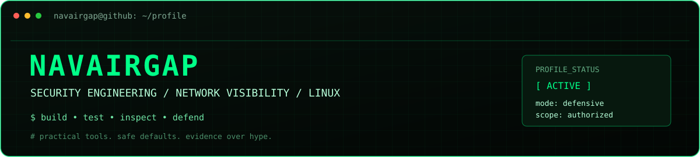

  <a href="https://github.com/navairgap?tab=repositories">Repositories</a>
  &nbsp;·&nbsp;
  <a href="https://navairgap.github.io">Portfolio</a>
  &nbsp;·&nbsp;
  <a href="https://3d-portfolio-nav-8975.vercel.app">3D portfolio</a>
  &nbsp;·&nbsp;
  <a href="https://navairgap.github.io/os/">Portfolio OS</a>

  
  
  
  
  

---

## `$ whoami`

Security-focused developer building practical tools for **network visibility, defensive automation, and Linux systems**. I like small, inspectable software with safe defaults, clear output, and tests that explain the expected behavior.

My repositories are a mix of implemented tools, experiments, and learning projects. I aim to keep their scope and maturity clear—no inflated claims, just code and evidence.

## `$ focus`

<table>
<tr>
<td width="50%" valign="top">

**01 / Network visibility**

DNS traffic analysis, home-network checks, device inventory, TLS behavior, and useful protocol-level diagnostics.

</td>
<td width="50%" valign="top">

**02 / Defensive engineering**

Input validation, bounded resources, safe failure modes, useful logs, regression tests, and CI gates.

</td>
</tr>
<tr>
<td width="50%" valign="top">

**03 / Systems**

Linux, Python, Rust, shell scripting, command-line utilities, and understanding how software interacts with the OS.

</td>
<td width="50%" valign="top">

**04 / Web**

TypeScript, React, APIs, retrieval systems, and practical application hardening.

</td>
</tr>
</table>

## `$ featured_work`

<table>
<tr>
<td width="34%" valign="top">

### [SentinelWiFi](https://github.com/navairgap/SentinelWiFi)

Local Wi-Fi and LAN health checks, device inventory, and explainable findings for networks you own or are authorized to assess.

</td>
<td width="33%" valign="top">

### [sentinel-dns](https://github.com/navairgap/sentinel-dns)

Heuristic detection of suspicious DNS domain patterns and bursts, with offline capture analysis, streaming input, JSONL alerts, and optional HTTPS webhooks.

</td>
<td width="33%" valign="top">

### [banter](https://github.com/navairgap/banter)

Real-time Socket.IO chat with origin checks, connection caps, event throttling, bounded payloads, and integration tests.

</td>
</tr>
<tr>
<td valign="top">

### [python-projects](https://github.com/navairgap/python-projects)

A collection of standard-library command-line tools with tests, including password generation, network diagnostics, disk auditing, and static file serving.

</td>
<td valign="top">

### [macabre](https://github.com/navairgap/learning-rust/tree/main/macabre)

A Linux CLI for inspecting, changing, and restoring network-interface MAC addresses.

</td>
<td valign="top">

### [nav-portfolio](https://github.com/navairgap/nav-portfolio)

A terminal-style portfolio with BM25 retrieval, optional semantic search, and a rate-limited API endpoint.

</td>
</tr>
</table>

More interface and systems experiments: [3D portfolio](https://github.com/navairgap/3d-portfolio) · [portfolio OS](https://github.com/navairgap/portfolio-os) · [dotfiles](https://github.com/navairgap/dotfiles).

## `$ principles`

- **Authorized scope only.** Test systems I own or have explicit permission to assess.
- **Safe by default.** Prefer local processing and passive observation where practical; validate untrusted input and bound resource use.
- **Evidence over hype.** Tests and CI help establish behavior, but a green build is not a security guarantee.
- **Document the limits.** Explain assumptions, failure modes, and what a tool does not do.

---

## Activity

## Contribution snake

<picture>
  <source media="(prefers-color-scheme: dark)" srcset="https://raw.githubusercontent.com/navairgap/navairgap/main/dist/github-snake-dark.svg" />
  <source media="(prefers-color-scheme: light)" srcset="https://raw.githubusercontent.com/navairgap/navairgap/main/dist/github-snake.svg" />
  
</picture>

---

<a href="https://github.com/navairgap?tab=repositories">[ VIEW REPOSITORIES ]</a>
&nbsp;·&nbsp;
<a href="https://navairgap.github.io">[ OPEN PORTFOLIO ]</a>

<code>build responsibly / measure honestly / keep learning</code>

## Profile maintenance

Keep the existing contribution graph and snake game when revising this profile. Verify referenced assets, use descriptive alt text, and do not present custom graphics as official GitHub achievements.

## Maintenance and verification notes

Add profile maintenance checks: preserve the contribution graph and snake game, verify asset paths, keep alt text useful, and distinguish official GitHub achievements from custom graphics.
