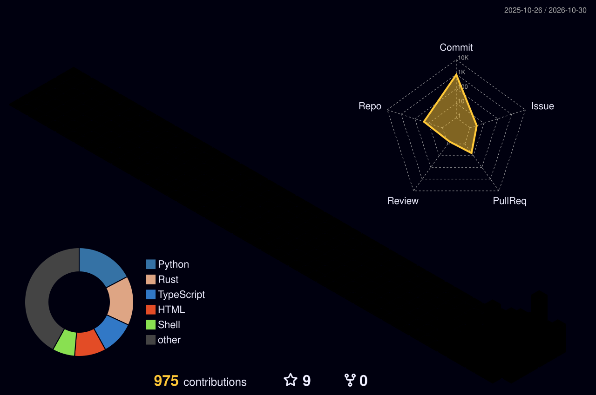

<div align="center">

<div align="center">
  
</div>

</div>

---

<table style="width:100%;table-layout:fixed;">
  <tr>
<td width="600" valign="top">

```zsh
root@navairgap ~ $ cat about.conf
```
```ini
[me]
name   = NAV
handle = navairgap
role   = Security Researcher × Backend Developer
motto  = defense is offense, inverted
home   = India · remote

[stack]
os      = Arch (btw)
editor  = neovim · zed
langs   = Python · Rust · C/C++ · JavaScript/TS · Solidity
backend = Node.js · Express · WebSockets · job queues
sec     = SDR (802.11) · honeypots · port knocking · TLS internals
infra   = Docker · GitHub Actions · GitHub Pages
lab     = navairgap OS — a Linux desktop in the browser

[field]
main = security tooling · backend systems
goal = kernels · offensive research
```

</td> <td width="15">
  <a href="https://navairgap.github.io">
    
  </a>
  <br/>
 </td>
</tr>
</table>

---

<div align="center">

```
┌───────────────────────────────────────────────────────┐
│  "defense is offense, inverted."                      │
│                                    — navairgap, daily │
└───────────────────────────────────────────────────────┘
```

</div>

---

<div align="center">

## &repeat=false" alt="repos typing" />

<a href="https://github.com/navairgap/python-projects"></a>
<a href="https://github.com/navairgap/learning-rust"></a>
<a href="https://github.com/navairgap/SentinelWiFi"></a>
<a href="https://github.com/navairgap/portfolio-os"></a>
<a href="https://github.com/navairgap/banter"></a>
<a href="https://github.com/navairgap/3d-portfolio"></a>
<a href="https://github.com/navairgap/dotfiles"></a>
<a href="https://github.com/navairgap/tls-probe"></a>

</div>

---

<div align="center">

## &repeat=false" alt="stats typing" />


</div>

---

<div align="center">

## &repeat=false" alt="stack typing" />

</div>

<br/>

<details>
<summary><b>⌿ &nbsp;Languages</b></summary><br/>
<p align="center">

</p>
</details>

<details>
<summary><b>⎋ &nbsp;Web & Backend</b></summary><br/>
<p align="center">

</p>
</details>

<details>
<summary><b>♾ &nbsp;Tools & Infra</b></summary><br/>
<p align="center">

</p>
</details>

<details>
<summary><b>⚔️ &nbsp;Security Arsenal</b></summary><br/>
<p align="center">


</p>
</details>

---

<div align="center">

**[navairgap.github.io](https://navairgap.github.io) — portfolio →**
**[3d-portfolio](https://3d-portfolio-nav-8975.vercel.app) — step inside the room →**
**[navairgap OS](https://navairgap.github.io/os/) — a portfolio you can boot →**


</div>

---

<div align="center">
<picture>
  <source media="(prefers-color-scheme: dark)" srcset="https://raw.githubusercontent.com/navairgap/navairgap/output/github-contribution-grid-snake-dark.svg" />
  <source media="(prefers-color-scheme: light)" srcset="https://raw.githubusercontent.com/navairgap/navairgap/output/github-contribution-grid-snake.svg" />
  
</picture>
</div>

---

<div align="center">

## 3D Contribution Graph

<picture>
  <source media="(prefers-color-scheme: dark)" srcset="./profile-3d-contrib/profile-night-rainbow.svg" />
  <source media="(prefers-color-scheme: light)" srcset="./profile-3d-contrib/profile-green-animate.svg" />
  
</picture>

</div>

<div align="center">

<sub>bone on black, forever — but green tonight</sub>

</div>
