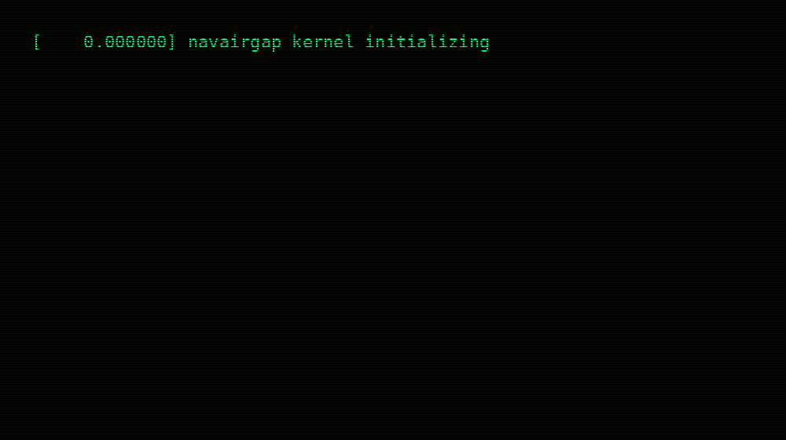
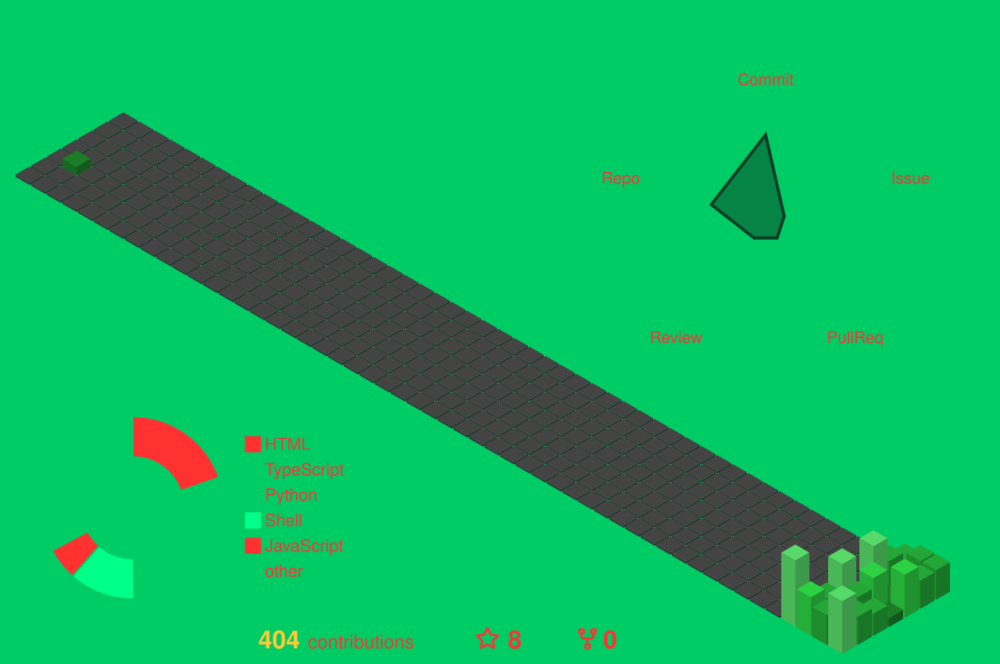

---

 

&nbsp;&nbsp;&nbsp;

&nbsp;&nbsp;&nbsp;

 

> *"the air gap between attacker and target is my favorite place to stand."*

 

## `◢ ops log — deployments`

&nbsp;&nbsp;  &nbsp; **[python-projects](https://github.com/navairgap/python-projects)** — six stdlib-only CLI tools, CI green on 3.9–3.12

&nbsp;&nbsp;  &nbsp; **[learning-rust](https://github.com/navairgap/learning-rust)** — `macabre`: your MAC, requiem'd · build+test+clippy+fmt gated

&nbsp;&nbsp;  &nbsp; **[SentinelWiFi](https://github.com/navairgap/SentinelWiFi)** — wifi deauth detection over RTL-SDR

&nbsp;&nbsp;  &nbsp; **[portfolio-os](https://github.com/navairgap/portfolio-os)** — a linux desktop that is a portfolio

&nbsp;&nbsp;  &nbsp; **[banter](https://github.com/navairgap/banter)** — zero-history chat, two-client integration tests in CI

&nbsp;&nbsp;  &nbsp; **[dotfiles](https://github.com/navairgap/dotfiles)** — Nothing OS × Hyprland · pill taskbar · dot widgets

&nbsp;&nbsp;  &nbsp; **[3d-portfolio](https://github.com/navairgap/3d-portfolio)** — photoreal room, browser-native, deployed

&nbsp;&nbsp;  &nbsp; **[tls-probe](https://github.com/navairgap/tls-probe)** — hand-rolled TLS inspection, socket-up

 

## `◢ the inversion`

<table align="center">
<tr>
<td width="380" valign="top">

**◤ DEFENSE — what i ship**

`honeypot-lite` — fake services, real logs
`SentinelWiFi` — deauth detection, SDR
`portwarden` — encrypted port knocking
`sentinel-dns` — exfil detection at the resolver
`macabre` — MAC privacy, one command

</td>
<td width="60" align="center" valign="middle">

`⇄`

</td>
<td width="380" valign="top">

**◥ OFFENSE — how i learn**

CTFs — pwn · crypto · web
deauth & wifi research, documented
adversarial tooling in throwaway repos
writeups with dead ends included
every defense starts as an attack

</td>
</tr>
</table>

 

## `◢ signal`

 

## `◢ stack`

 

 

 

**[navairgap.github.io](https://navairgap.github.io)** — the lab, live →
&nbsp;·&nbsp;
**[3d-portfolio](https://3d-portfolio-nav-8975.vercel.app)** — step inside the room →
&nbsp;·&nbsp;
**[navairgap OS](https://navairgap.github.io/os/)** — a portfolio you can boot →

---

<picture>
  <source media="(prefers-color-scheme: dark)" srcset="https://raw.githubusercontent.com/navairgap/navairgap/main/dist/github-snake-dark.svg" />
  <source media="(prefers-color-scheme: light)" srcset="https://raw.githubusercontent.com/navairgap/navairgap/main/dist/github-snake.svg" />
  
</picture>

◢ green for the defense. red for the rest.

