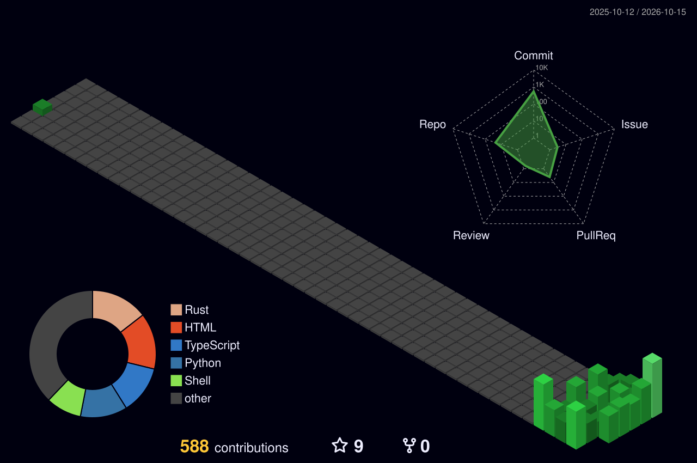

<div align="center">



<p>
  <a href="https://github.com/navairgap?tab=repositories">REPOSITORIES</a>
  &nbsp; / &nbsp;
  <a href="https://navairgap.github.io">PORTFOLIO</a>
  &nbsp; / &nbsp;
  <a href="https://3d-portfolio-nav-8975.vercel.app">3D LAB</a>
  &nbsp; / &nbsp;
  <a href="https://navairgap.github.io/os/">PORTFOLIO OS</a>
</p>

<code>PYTHON</code> &nbsp; <code>RUST</code> &nbsp; <code>TYPESCRIPT</code> &nbsp; <code>LINUX</code> &nbsp; <code>NETWORKS</code>

</div>

---

## `$ whoami`

Security-focused developer interested in **network visibility, defensive tooling, and Linux systems**. I build small tools to inspect behavior, make useful findings readable, and test edge cases before shipping.

I prefer code you can follow, defaults that are difficult to misuse, and documentation that says what a project does — and what it does not.

## `$ work --featured`

<table>
  <tr>
    <td width="50%" valign="top">

**[01 · SentinelWiFi](https://github.com/navairgap/SentinelWiFi)**

Wi-Fi and LAN health checks for authorized environments. Audits local configuration, inventories devices, and presents findings with practical context.

    </td>
    <td width="50%" valign="top">

**[02 · sentinel-dns](https://github.com/navairgap/sentinel-dns)**

Resolver-side DNS analysis for suspicious domain patterns and bursts, with offline capture analysis, streaming input, JSONL alerts, and optional HTTPS webhooks.

    </td>
  </tr>
  <tr>
    <td width="50%" valign="top">

**[03 · banter](https://github.com/navairgap/banter)**

A real-time chat app used to work on event handling, origin checks, connection limits, payload bounds, and integration testing.

    </td>
    <td width="50%" valign="top">

**[04 · python-projects](https://github.com/navairgap/python-projects)**

A collection of standard-library CLI tools: password generation, todo tracking, weather, disk auditing, network diagnostics, and static file serving.

    </td>
  </tr>
  <tr>
    <td width="50%" valign="top">

**[05 · macabre](https://github.com/navairgap/learning-rust/tree/main/macabre)**

A Linux CLI for inspecting, changing, and restoring network-interface MAC addresses, with system-level operations kept explicit.

    </td>
    <td width="50%" valign="top">

**[06 · nav-portfolio](https://github.com/navairgap/nav-portfolio)**

A terminal-inspired web portfolio with lexical retrieval, optional semantic search, and a rate-limited API endpoint.

    </td>
  </tr>
</table>

Other experiments: [3D portfolio](https://github.com/navairgap/3d-portfolio) · [portfolio OS](https://github.com/navairgap/portfolio-os) · [dotfiles](https://github.com/navairgap/dotfiles).

## `$ operating_principles`

```text
01  AUTHORIZED SCOPE  — assess only systems I own or have permission to test
02  SAFE DEFAULTS     — validate input, limit resources, fail clearly
03  EVIDENCE FIRST    — tests show behavior; they do not prove security
04  HONEST DOCS       — describe limits, assumptions, and failure modes
```

## `$ stack`

`Python` / `Rust` / `TypeScript` / `JavaScript` / `Bash`
`Linux` / `Networking` / `HTTP & TLS` / `DNS` / `GitHub Actions`

---

## Activity

<div align="center">




</div>

## Contribution snake

<div align="center">

<picture>
  <source media="(prefers-color-scheme: dark)" srcset="https://raw.githubusercontent.com/navairgap/navairgap/main/dist/github-snake-dark.svg" />
  <source media="(prefers-color-scheme: light)" srcset="https://raw.githubusercontent.com/navairgap/navairgap/main/dist/github-snake.svg" />
  
</picture>

</div>

---

<div align="center">

<a href="https://github.com/navairgap?tab=repositories"><code>[ LIST REPOSITORIES ]</code></a>
&nbsp; / &nbsp;
<a href="https://navairgap.github.io"><code>[ OPEN PORTFOLIO ]</code></a>


<sub><code>build responsibly · measure honestly · keep learning</code></sub>

</div>
